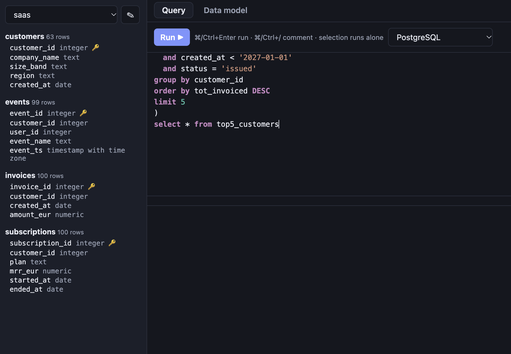
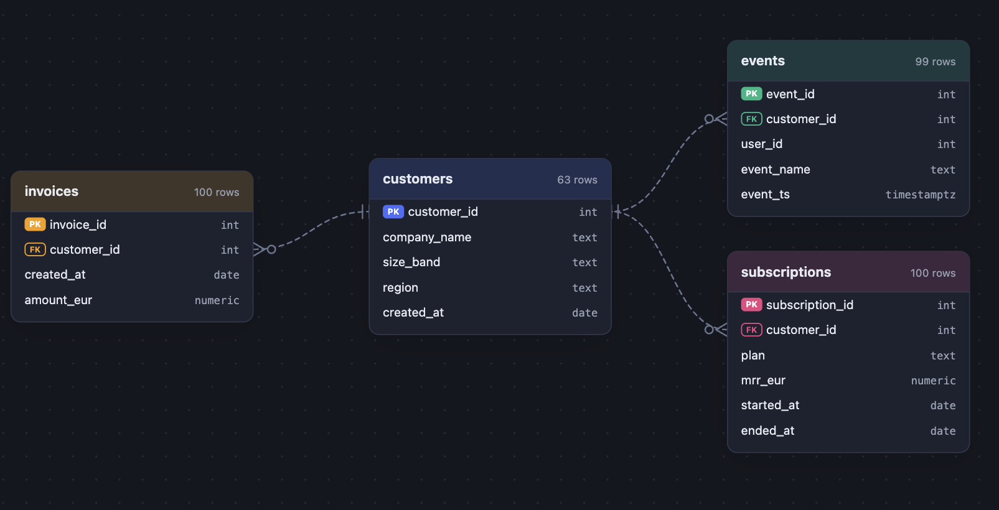

# SQL Playground

A local SQL practice environment for interview prep. Describe a schema in chat, get a seeded dataset, and query it in the browser against a **real PostgreSQL** engine, with an optional **Snowflake** mode and an interactive **ER diagram**.

| Query editor | Data model |
|---|---|
|  |  |

## Quick start

```bash
npm install
npm start                      # http://localhost:8000  (PORT=9000 npm start to change)
```

Optional, for Snowflake mode:

```bash
python3 -m venv .venv && .venv/bin/pip install -r requirements.txt
```

Requires Node 18+ (and Python 3 only for Snowflake mode and the data generators). No Postgres install: the engine is [PGlite](https://github.com/electric-sql/pglite), PostgreSQL compiled to WebAssembly, running in-process.

## Features

**Query tab**
- PostgreSQL SQL editor with syntax highlighting (keywords, strings, numbers, functions, green italic comments).
- `-- line` and `/* block */` comments. `⌘/Ctrl+/` toggles comments on the current line or selection.
- `⌘/Ctrl+Enter` runs the whole script, or only the highlighted selection. Multiple statements are supported; the last result is shown.
- Results grid with right-aligned numbers, `NULL` highlighting, row count and timing. Output is capped at 1000 rows. Errors show Postgres' message and character position.
- `INSERT/UPDATE/DELETE/DDL` work. **Reset data** restores the dataset from its `.sql` file.
- Dialect switch: **PostgreSQL** or **Snowflake (translated)**. See below.
- Resizable layout: drag the divider between editor and results, and the one between sidebar and main area (double-click resets). Sizes are remembered.
- Sidebar lists every table and column with types and row counts. Click a column or table name to insert it into the editor.

**Data model tab**
- ER diagram with crow's-foot notation, PK/FK badges and nullable (optional) markers.
- Uses declared foreign keys. If a dataset declares none, relationships are inferred from matching key column names and drawn dashed.
- Drag cards, pan (scroll or drag background), zoom (`⌘/Ctrl`+scroll or pinch), Fit, animated Auto-layout, "Keys only" compact mode. Positions are remembered per dataset.
- Hover a table, column or relationship to highlight what it connects to. Click a table for an inspector (row count, PK, references, referenced by). Double-click, or use **Query table**, to jump to `SELECT * ... LIMIT 100`.
- Shortcuts: `F` fit, `+`/`-` zoom, `Esc` deselect.

**Datasets**
- Several datasets side by side, selectable from the dropdown. Each one is its own in-memory database.
- **Rename** a data model with the ✎ button (display name only, stored in `datasets/labels.json`, git-ignored).

## Snowflake mode

Snowflake can't run locally, so your Snowflake SQL is translated to Postgres with [sqlglot](https://github.com/tobymao/sqlglot) and executed on the same data. The "Executed as PostgreSQL" panel shows the translated query. Column headers come back upper-cased like Snowflake.

Covered: `QUALIFY`, `IFF`, `ZEROIFNULL`, `NVL`, `DATEADD`, `DATEDIFF`, `LISTAGG`, `TRY_CAST`, `TO_DATE`, `ILIKE`, JSON paths such as `col:key::string`.
Not covered or approximate: `VARIANT`/`FLATTEN`, `SAMPLE`, `MERGE`, Snowflake-only functions, and exact type semantics (`NUMBER`, `TIMESTAMP_NTZ`). `DATE_TRUNC` on a date returns a timestamp, where Snowflake returns a date.

Treat it as a learning aid, not proof a query runs unchanged on Snowflake.

## Included datasets

| File | Contents |
|---|---|
| `datasets/saas.sql` | `customers`, `subscriptions`, `invoices`, `events` (~100 rows each) with deliberate real-world mess: duplicates, orphans, NULLs, casing and whitespace variants, negative and outlier amounts, ended-before-started subscriptions, future and epoch dates, tz offsets. No foreign keys, so the diagram shows inferred relationships. |
| `datasets/saas_extended.sql` | Same domain, extended and **consistent**: `customers` (sector), `subscriptions`, `invoices` (type, status), `events` (JSONB `properties`), `hubspot_customers`. 60 customers, ~4.4k invoices, 7k events, enforced foreign keys, plan changes, churn and returning customers. Built for cohort retention, MRR movement and JSON exercises. |

## Adding your own dataset

1. Drop a `datasets/<name>.sql` file with `CREATE TABLE` and `INSERT` statements (PostgreSQL). It appears after a page reload, no restart needed.
2. Optionally write a generator under `generators/` for reproducible seeded data:
   ```bash
   python3 generators/saas.py            # -> datasets/saas.sql
   python3 generators/saas_extended.py   # -> datasets/saas_extended.sql
   ```
   Generators are deterministic (fixed random seed).

If you use Claude Code, you can simply describe a schema in chat ("create this schema: ... add ~100 rows, include real-world inconsistencies") and have it generate the dataset file and generator for you.

## Project layout

```
server.mjs            HTTP server + PGlite engine, schema/FK introspection, rename API
translate.py          Snowflake -> PostgreSQL translator (sqlglot)
static/index.html     the whole UI (editor, results, ER diagram), no build step
datasets/             one .sql file per dataset
generators/           seeded dataset generators
docs/                 screenshots
```

API (all JSON): `GET /api/datasets` (tables, columns, relations, labels), `POST /api/query`, `POST /api/reset`, `POST /api/rename`.

## Notes

- Everything runs on `127.0.0.1` only. There is no authentication; don't expose the port.
- Data is in memory: restarting the server or pressing Reset reloads the original files.
